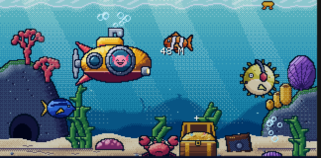

# Aquarium 1.1.2

用水下滤波、共振和回声处理吉他，潜艇与海景跟随控制变化。

先安装下表的配套算法包，再安装 App。

| 文件 | 版本 |
| --- | --- |
| [App.rpk](App.rpk) | Aquarium 1.1.2 |
| [Audio-Pack.rpk](Audio-Pack.rpk) | Deep Water 1.0.1 |

[套件说明](套件说明.md) · [App 源码](source/) · [配套算法源码](source/dsp/) · [版本和校验值](manifest.json) · [社区发布文案](社区发布文案.md)
