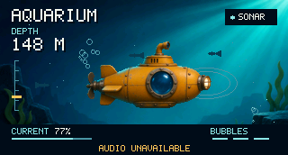

# Aquarium



把潜艇往下开，吉他的高频会慢慢收起来，剩下水下的共振和回声。

## 配套音频包

先安装音频包，再安装 App。

- Deep Water `org.resona.creative.aquarium.voice` 1.0.1

## 两个编码器

| 页面／模式 | 上方旋转 | 上方短按 | 上方长按 | 下方旋转 | 下方短按 | 下方长按／按住 |
| --- | --- | --- | --- | --- | --- | --- |
| Aquarium | 调潜水深度与水下音色 | 声呐开／关 | 无功能 | 调水流晃动强度 | 气泡少／中／多 | 长按重置 |

## 项目详细说明

# Aquarium

Your guitar is playing underwater. A Box App (320 × 172 underwater scene) that drives its own nested
effect pack, **Deep Water** (`dsp/`). Install the pack and the App; the App starts the effect itself.

## Controls

| Control | Turn | Click | Long press |
| --- | --- | --- | --- |
| SELECTOR (top) | DEPTH: the submarine dives and rises | Sonar on / off | |
| CUSTOMIZE (bottom) | CURRENT | BUBBLES: few / some / lots | Reset |

Settings are saved.

## Controller

The Web and Mobile controllers, or any MIDI controller, play Aquarium over MIDI channel 1; CC 119
asks the App for every value. Hold DIVE, RISE, PING or STORM to take the sea somewhere for as long
as you hold it (DIVE wins over RISE).

| CC | Control | Values |
| --- | --- | --- |
| 20 | Depth | 0..127 = 0..100 % (0..200 m) |
| 21 | Current | 0..127 = 0..100 % |
| 22 | Bubbles | 0 few, 1 some, 2 lots |
| 23 | Sonar | 0 off, 1 on |
| 24 | Sonar echo | 0..127 = 0..100 % |
| 25 | Mix | 0..127 = 0..100 % |
| 26 | Level | 0..127 = -12..+6 dB |
| 30 | DIVE (hold) | 127 press, 0 release: DEPTH 100, the sea floor |
| 31 | RISE (hold) | DEPTH 0, the sunny shallows |
| 32 | PING (hold) | sonar on at 100 % |
| 33 | STORM (hold) | CURRENT 100 and lots of bubbles |

## The scene

- **DEPTH** moves the submarine smoothly from the shallows to 200 m and rolls off the guitar's high frequencies.
- **CURRENT** sets the speed of the drifting particles and the submarine’s sway. The sway follows Deep Water’s modulation rate and slows with depth.
- **BUBBLES** controls the bursts from the propeller when you play. Deeper water produces larger, lower-pitched bubbles.
- **SONAR** adds a diffused echo to what you play. The display follows the input meter and shows successive returns at 560 ms intervals.

On startup, a sonar pulse appears first, then the submarine dives into view.

## Deep Water (dsp/)

```
input -> CURRENT (two vibrato taps, sine + random drift)
      -> DEPTH (low-pass 9 kHz .. 600 Hz with a pressure resonance, Q 0.7 .. 2.8)
      -> cave reverb (1.4 .. 6.4 s, darker as you dive)
      +  SONAR (560 ms echo, low-passed and diffused again on every return)
      +  BUBBLES (rising sine bloops: a run on each pick, strays while you play)
      -> MIX -> LEVEL -> limiter
```

| Parameter | Range | Default |
| --- | --- | --- |
| DEPTH | 0 .. 100 % | 40 |
| CURRENT | 0 .. 100 % | 35 |
| BUBBLES | 0 .. 100 % | 50 |
| SONAR | 0 .. 100 % | 0 (sonar on: Sonar echo, 75 unless a controller sets it) |
| MIX | 0 .. 100 % | 80 (controller) |
| LEVEL | -12 .. +6 dB | 0 (controller) |

Deeper water also slows the current, lowers the bubbles' pitch and lengthens the reverb.

## Build

```
resona-lab build dsp && resona-lab pack build dsp
resona-lab app build .
swift tools/encode_scene.swift assets/seafloor.png assets/submarine.png src/scene.h
python3 tools/make_splash.py
```

## Changes

- 1.1.2 — New submarine scene and matching startup animation. Falls back to dry guitar if Deep Water cannot start.
